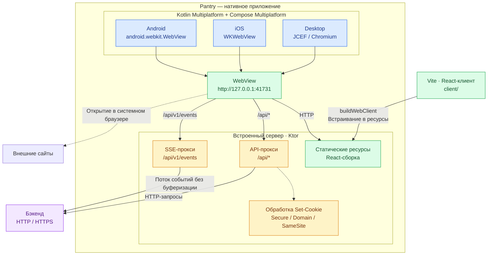

# Pantry — нативные приложения (Android, iOS, Desktop)

Kotlin Multiplatform + Compose Multiplatform. Приложения показывают React-интерфейс из [`client/`](./client)
в нативном WebView и общаются с бэкендом.

## Как это устроено

- React-клиент собирается vite'ом при сборке приложения (задача `:shared:buildWebClient`)
  и встраивается в ресурсы — интерфейс открывается мгновенно и без отдельного хостинга фронта.
- Встроенный сервер работает так же, как vite-прокси в dev-режиме: фронт и `/api` живут на одном
  origin, поэтому cookie с refresh-токеном работают без CORS. У `Set-Cookie` от бэкенда снимаются
  `Secure`/`Domain`, `SameSite=None` меняется на `Lax` (иначе WebView не сохранит cookie на http://127.0.0.1).
- SSE (`/api/v1/events`) проксируется потоково, без буферизации.
- Ссылки на сторонние сайты открываются в системном браузере.

WebView по платформам: Android — `android.webkit.WebView`, iOS — `WKWebView`,
Desktop — встроенный Chromium (JCEF). На десктопе при **первом** запуске движок (~100 МБ)
скачивается в `~/Library/Application Support/Pantry` (Windows: `%APPDATA%\Pantry`, Linux: `~/.local/share/pantry`).

Код: [`shared/src/commonMain`](./shared/src/commonMain/kotlin/com/crzto3/pantry) — экран подключения/настроек
и [встроенный сервер](./shared/src/commonMain/kotlin/com/crzto3/pantry/server/LocalServer.kt);
платформенные WebView — в `androidMain`, `iosMain`, `jvmMain`.

## Адрес бэкенда

- По умолчанию: `http://localhost:8080` (Desktop, iOS-симулятор), `http://10.0.2.2:8080` (Android-эмулятор → хост-машина).
- Задать при сборке: `-Ppantry.backendUrl=https://pantry.example.com` (или строкой в `gradle.properties`).
- Поменять в приложении: если сервер недоступен, появится экран с кнопкой «Адрес сервера».
  На десктопе — меню **Pantry → Адрес сервера…** (⌘, / Ctrl+,), там же «Обновить» (⌘R / Ctrl+R).

## Сборка и запуск

Нужны Node.js (для сборки клиента), JDK 21+, Android SDK, Xcode — для iOS.

- Desktop: `./gradlew :desktopApp:run`
  - установщик: `./gradlew :desktopApp:packageDmg` (`packageMsi` на Windows, `packageDeb` на Linux)
- Android: `./gradlew :androidApp:assembleDebug` (или `installDebug` на подключённое устройство)
- iOS: открыть [`iosApp`](./iosApp) в Xcode и запустить
- Тесты: `./gradlew :shared:jvmTest`

Флаг `-Ppantry.skipWebBuild=true` пропускает пересборку React-клиента (берётся предыдущая сборка).

## Ограничения

- Вход через Telegram-виджет внутри приложения не заработает: Telegram проверяет домен
  (`/setdomain` у бота), а интерфейс открыт с `127.0.0.1`. Вход по email/паролю работает.
- Для бэкенда без TLS (`http://`) включены `usesCleartextTraffic` (Android) и `NSAllowsArbitraryLoads` (iOS);
  для продакшена с https их можно отключить.
