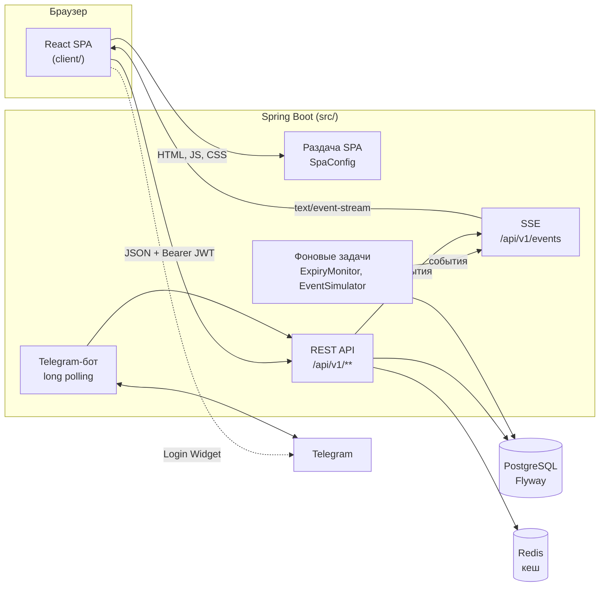
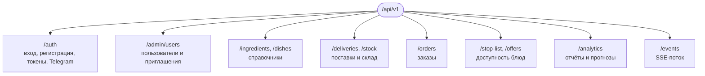
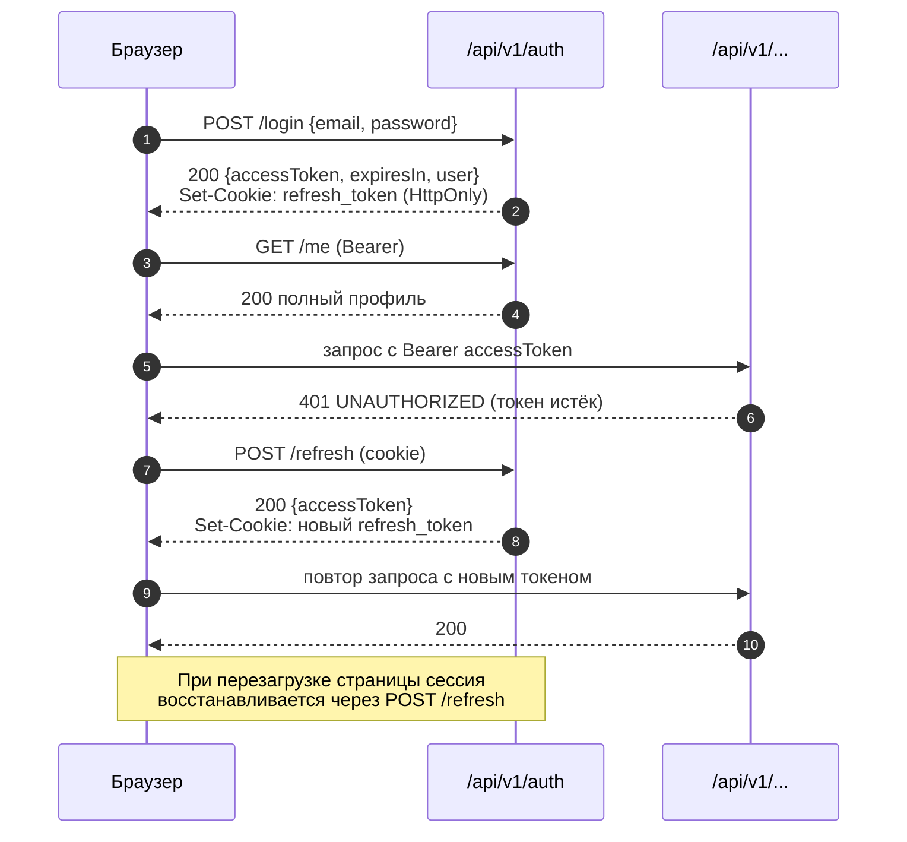
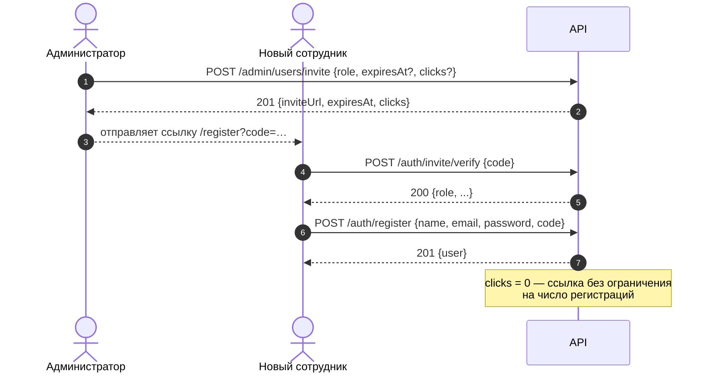
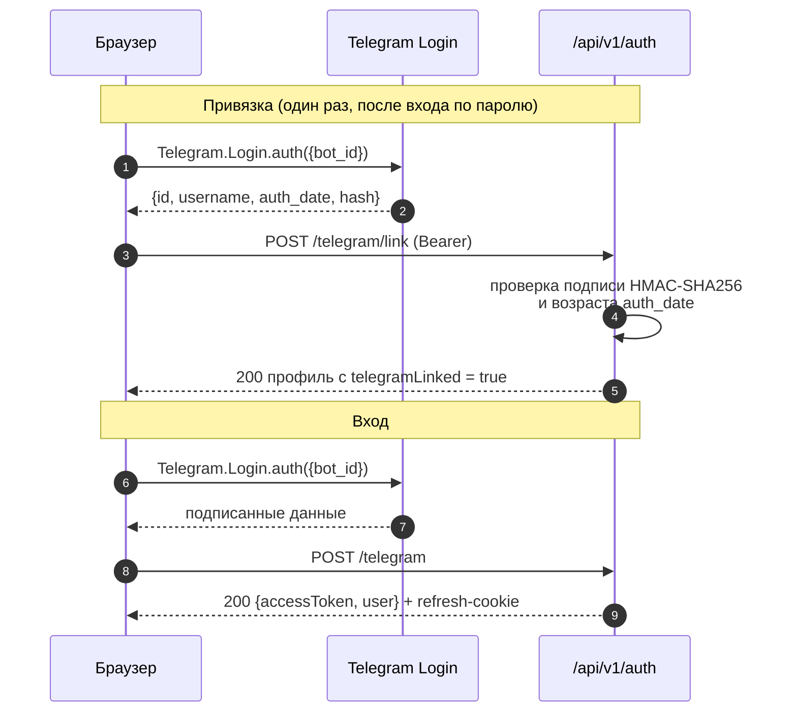
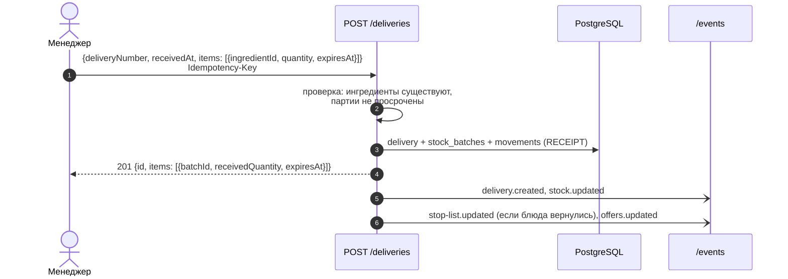
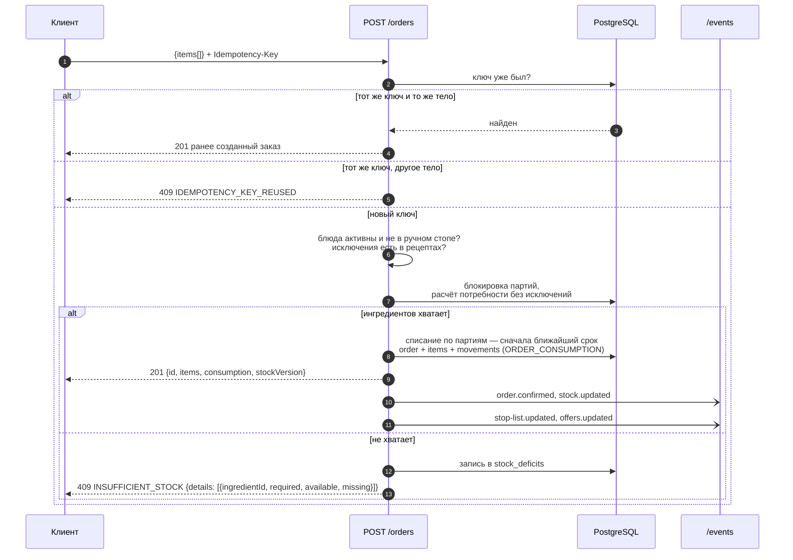
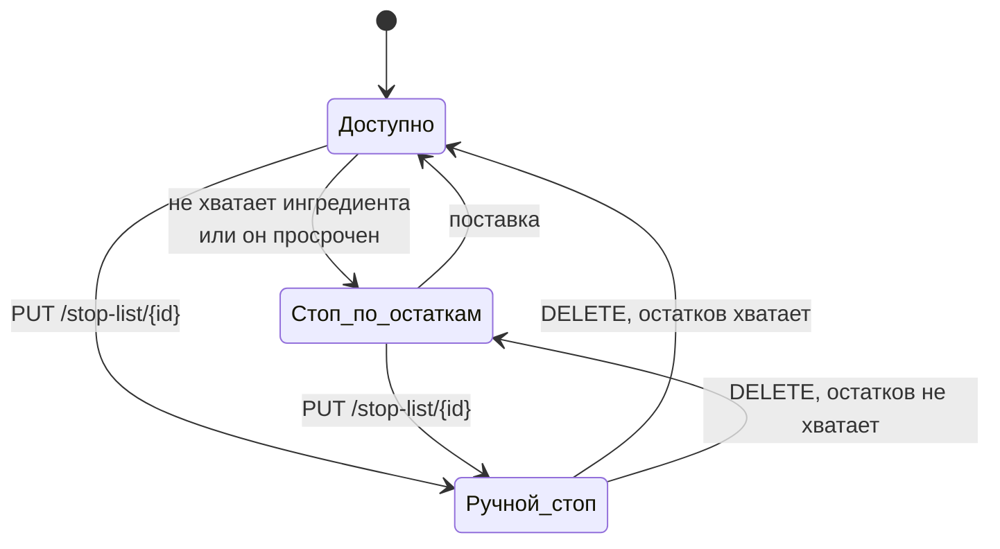
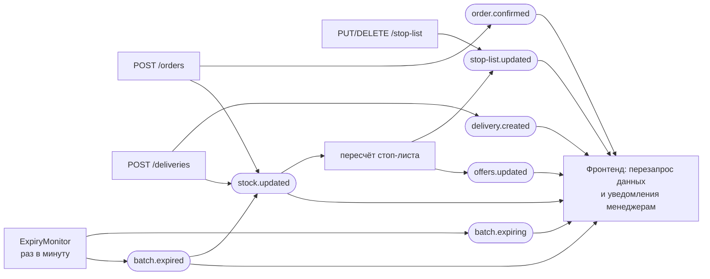
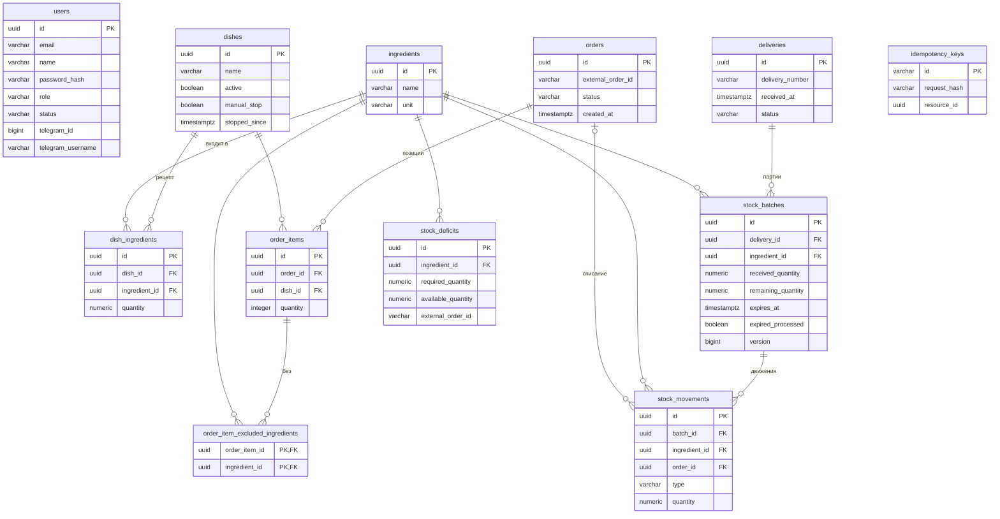

# Pantry — учёт склада и меню ресторана

Pantry следит за остатками ингредиентов, сроками годности партий и доступностью блюд. Каждый заказ списывает ингредиенты со склада, а блюда, для которых чего-то не хватает, автоматически попадают в стоп-лист. Менеджеры видят прогнозы закупок, аналитику и календарь сроков, получают обновления в реальном времени и могут работать через Telegram-бота.

Проект сделан на хакатоне UmirHack (команда «Флагман»).

## Содержание

- [Возможности](#возможности)
- [Архитектура](#архитектура)
- [Стек](#стек)
- [Структура репозитория](#структура-репозитория)
- [Быстрый старт](#быстрый-старт)
- [Переменные окружения](#переменные-окружения)
- [Роли и доступ](#роли-и-доступ)
- [API](#api)
- [События в реальном времени (SSE)](#события-в-реальном-времени-sse)
- [Модель данных](#модель-данных)
- [Фронтенд](#фронтенд)
- [Telegram-бот](#telegram-бот)
- [Симулятор нагрузки](#симулятор-нагрузки)
- [Тесты](#тесты)
- [Сборка и деплой](#сборка-и-деплой)

## Возможности

| Область | Что умеет |
|---|---|
| Заказы | Приём заказа с проверкой остатков, списание по партиям (сначала те, у которых срок ближе), заказ блюда без части ингредиентов, защита от дублей через `Idempotency-Key` |
| Склад | Приёмка поставок партиями со сроком годности, остатки по ингредиентам, автосписание просрочки, предупреждения об истекающих сроках |
| Меню | Автоматический стоп-лист по остаткам и просрочке, ручной стоп-лист, «горячие предложения» — блюда из ингредиентов, которые скоро испортятся |
| Аналитика | Продажи и расход за день, списания, дефициты, прогноз стоп-листа, рекомендации по закупкам |
| Календарь | Сроки годности партий, принятые поставки и даты, к которым нужна закупка |
| Пользователи | Регистрация только по приглашению, роли, блокировка, вход по паролю или через Telegram |
| Реальное время | SSE-поток событий: интерфейс обновляется сам при заказах, поставках и изменениях стоп-листа |

## Архитектура



Фронтенд собирается в `src/main/resources/static`, и Spring Boot отдаёт его вместе с API с одного адреса. При разработке фронт можно запускать отдельно через Vite, он проксирует `/api` на бэкенд.

## Стек

| Часть | Технологии |
|---|---|
| Бэкенд | Java 25, Spring Boot 4.1 (Web MVC, Data JPA, Validation, Cache), PostgreSQL, Flyway, Redis, JJWT, Argon2 (Spring Security Crypto), Lombok |
| Фронтенд | React 19, TypeScript, Vite, Tailwind CSS 4, TanStack Query, React Router, Recharts, Radix Dialog, Framer Motion, Zustand, Day.js |
| Тесты | JUnit 5, Testcontainers (PostgreSQL, Redis), AssertJ |
| Инструменты | Maven Wrapper, Docker, Python-скрипт симуляции (uv), коллекция Postman |

## Структура репозитория

```text
.
├── client/                     фронтенд (React + Vite)
│   └── src/
│       ├── app/                точка входа, роутинг, глобальные стили
│       ├── pages/              страницы: dashboard и её подстраницы, calendar, profile, login, register
│       ├── widgets/            крупные блоки: header, таблицы, графики, диалоги, Telegram-вход
│       ├── shared/             auth, хуки, таблица, тосты, SSE, кнопка «Наверх»
│       └── lib/                api-клиент, типы, утилиты, конфиг навигации
├── src/main/java/.../UmirHack_Flagman/
│   ├── auth/                   регистрация, вход, JWT, refresh, приглашения, админка пользователей
│   ├── catalog/                ингредиенты и блюда
│   ├── inventory/              поставки, партии, остатки, движения склада, контроль сроков
│   ├── orders/                 заказы, списание, дефициты
│   ├── menu/                   стоп-лист и горячие предложения
│   ├── analytics/              отчёты и прогнозы
│   ├── events/                 SSE-рассылка событий
│   ├── telegram/               бот и проверка подписи Telegram Login
│   ├── demo/                   демо-данные и симулятор событий
│   └── common/                 ошибки, пагинация, идемпотентность, CORS, раздача SPA
├── src/main/resources/
│   ├── application.properties
│   ├── db/migration/           миграции Flyway
│   └── static/                 собранный фронтенд (генерируется, в git не хранится)
├── src/test/                   интеграционные тесты на Testcontainers
├── scripts/                    симулятор работы ресторана через API
├── postman/                    коллекция запросов
└── Dockerfile
```

## Быстрый старт

### 1. PostgreSQL и Redis

```bash
docker run --name UmirHack -p 5432:5432 -e POSTGRES_DB=UmirFlagman -e POSTGRES_USER=admin -e POSTGRES_PASSWORD=123456 -d postgres
```

```bash
docker run --name UmirHackRedis -p 6379:6379 -d redis:7
```

### 2. Настройки

```bash
cp .env.example .env
```

Бэкенд сам читает `.env` из текущей директории (`spring.config.import=optional:file:.env`). Переменные окружения ОС важнее значений из файла.

Фронтенду нужен ID Telegram-бота для кнопки входа:

```bash
cp client/.env.example client/.env.local
```

### 3. Бэкенд

```bash
./mvnw spring-boot:run
```

API поднимется на `http://localhost:8080`. При первом запуске Flyway создаст схему, а при `SEED_ENABLED=true` загрузятся демо-данные. Первый администратор создаётся из `ADMIN_EMAIL` и `ADMIN_PASSWORD`.

### 4. Фронтенд

Режим разработки с горячей перезагрузкой, `/api` проксируется на `:8080`:

```bash
npm --prefix client install
```

```bash
npm --prefix client run dev
```

Откройте `http://localhost:5173`.

Или соберите фронт в бэкенд и работайте с одного адреса `http://localhost:8080`:

```bash
npm --prefix client run build:backend
```

## Переменные окружения

### Бэкенд (`.env`)

| Переменная | По умолчанию | Назначение |
|---|---|---|
| `DB_URL`, `DB_USERNAME`, `DB_PASSWORD` | `jdbc:postgresql://localhost:5432/UmirFlagman` | Подключение к PostgreSQL |
| `REDIS_HOST`, `REDIS_PORT` | `localhost`, `6379` | Подключение к Redis |
| `JWT_SIGNING_KEY` | dev-ключ | Ключ подписи access-токенов. **В проде обязательно задать свой** |
| `JWT_ISSUER`, `JWT_AUDIENCE` | `umirhack-flagman`, `restaurant-management-api` | Поля JWT |
| `JWT_ACCESS_TTL` | `15m` | Время жизни access-токена |
| `REFRESH_TOKEN_TTL` | `30d` | Время жизни refresh-токена |
| `AUTH_COOKIE_SECURE` | `false` | Флаг `Secure` у refresh-cookie. По `http` (кроме `localhost`) должен быть `false`, иначе браузер не сохранит cookie |
| `AUTH_COOKIE_SAME_SITE` | `Lax` | `SameSite` у refresh-cookie |
| `ADMIN_EMAIL`, `ADMIN_PASSWORD`, `ADMIN_NAME` | — | Первый администратор, создаётся при старте |
| `SEED_ENABLED` | `true` | Загрузка демо-меню, ингредиентов и поставок |
| `SIMULATOR_ENABLED` | `false` | Встроенный генератор событий раз в 5 секунд |
| `EXPIRY_WARNING_HOURS` | `24` | За сколько часов партия считается «истекающей» |
| `AUTO_WRITE_OFF` | `true` | Автоматически списывать просроченные партии |
| `INVITE_BASE_URL` | `http://localdev.com:8080/register?code={code}` | Шаблон ссылки-приглашения, `{code}` подставляется |
| `INVITE_TTL` | `48h` | Срок действия приглашения по умолчанию |
| `APP_TIMEZONE` | `Europe/Moscow` | Часовой пояс для дневных отчётов |
| `TELEGRAM_BOT_TOKEN` | — | Токен бота. Без него вход через Telegram и бот выключены |
| `TELEGRAM_BOT_USERNAME` | — | Имя бота |
| `TELEGRAM_POLLING` | `true` | Опрашивать ли Telegram на входящие команды |

### Фронтенд (`client/.env.local`)

| Переменная | Назначение |
|---|---|
| `VITE_TELEGRAM_BOT_ID` | Числовой ID бота (часть токена до двоеточия) для кнопки «Войти через Telegram». Встраивается в сборку |
| `VITE_API_URL` | Базовый адрес API, по умолчанию `/api/v1` |

## Роли и доступ

| Роль | Код | Что доступно |
|---|---|---|
| Сотрудник | `employee` | Меню и блюда, приём заказов, стоп-лист и горячие предложения (просмотр) |
| Менеджер | `manager` | Всё, что сотруднику, плюс склад, поставки, список заказов, аналитика, календарь, ручной стоп-лист, вход через Telegram |
| Администратор | `admin` | Всё, что менеджеру, плюс пользователи, приглашения, создание ингредиентов и блюд |

В таблицах API: **все** — любой авторизованный пользователь, **staff** — `manager` и `admin`, **admin** — только `admin`, **публичный** — без токена.

## API

Базовый путь: `/api/v1`. Формат — JSON. Авторизация — заголовок `Authorization: Bearer <accessToken>`. Списки постраничные: параметры `page` (с 1) и `limit` (1–100, по умолчанию 20), в ответе `items`, `page`, `limit`, `total`.



### Ошибки

Все ошибки приходят в одном формате:

```json
{
  "error": {
    "code": "INSUFFICIENT_STOCK",
    "message": "Недостаточно ингредиентов для создания заказа",
    "details": [],
    "requestId": "req-..."
  }
}
```

Частые коды:

| HTTP | Код | Когда |
|---|---|---|
| 400 | `VALIDATION_ERROR` | Некорректные поля, параметры или формат запроса |
| 400 | `INGREDIENT_NOT_IN_DISH` | В исключениях заказа указан ингредиент не из рецепта |
| 401 | `UNAUTHORIZED` | Нет или истёк access-токен |
| 401 | `INVALID_REFRESH_TOKEN` | Refresh-cookie отсутствует или недействительна |
| 403 | `FORBIDDEN` | Не хватает прав роли |
| 404 | `DISH_NOT_FOUND`, `ORDER_NOT_FOUND`, `DELIVERY_NOT_FOUND` … | Сущность не найдена |
| 409 | `INSUFFICIENT_STOCK` | Не хватает ингредиентов, в `details` — что и сколько |
| 409 | `DISH_UNAVAILABLE` | Блюдо в стоп-листе или неактивно |
| 409 | `IDEMPOTENCY_KEY_REUSED` | Тот же `Idempotency-Key` с другим телом запроса |
| 409 | `LAST_ADMIN_REQUIRED` | Попытка понизить или заблокировать последнего администратора |
| 503 | `STOCK_LOCK_TIMEOUT` | Склад занят параллельной операцией, повторите запрос |

### Аутентификация

| Метод | Путь | Доступ | Описание |
|---|---|---|---|
| POST | `/auth/invite/verify` | публичный | Проверить код приглашения, узнать роль |
| POST | `/auth/register` | публичный | Регистрация по коду приглашения |
| POST | `/auth/login` | публичный | Вход по почте и паролю |
| POST | `/auth/telegram` | публичный | Вход через Telegram Login (только `manager`, `admin` с привязанным Telegram) |
| POST | `/auth/refresh` | публичный | Новый access-токен по refresh-cookie |
| POST | `/auth/logout` | публичный | Выход, refresh-cookie удаляется |
| GET | `/auth/me` | все | Текущий пользователь, включая `telegramLinked` |
| POST | `/auth/telegram/link` | staff | Привязать Telegram к аккаунту |
| DELETE | `/auth/telegram/link` | все | Отвязать Telegram |

Access-токен короткоживущий и хранится только в памяти фронтенда. Refresh-токен лежит в `HttpOnly` cookie с путём `/api/v1/auth` и при каждом обновлении заменяется новым.



Регистрация возможна только по приглашению администратора:



Вход через Telegram:



### Пользователи (админка)

| Метод | Путь | Доступ | Описание |
|---|---|---|---|
| GET | `/admin/users` | admin | Список; фильтры `search`, `role`, `status` |
| GET | `/admin/users/{userId}` | admin | Пользователь |
| PATCH | `/admin/users/{userId}` | admin | Изменить имя или почту |
| PATCH | `/admin/users/{userId}/role` | admin | Сменить роль: `{role}` |
| PATCH | `/admin/users/{userId}/status` | admin | `{status: active \| blocked}`; блокировка отзывает все сессии |
| POST | `/admin/users/invite` | admin | Создать приглашение: `{role, expiresAt?, clicks?}` (0–1000, 0 — без лимита, срок до 30 дней) |
| DELETE | `/admin/users/invite/{code}` | admin | Отозвать приглашение |

### Справочники

| Метод | Путь | Доступ | Описание |
|---|---|---|---|
| GET | `/ingredients` | все | Ингредиенты; `search` |
| POST | `/ingredients` | admin | Создать пачкой: `{items: [{name, unit: g \| ml \| pcs}]}` |
| GET | `/dishes` | все | Блюда с составом; `search`, `active` |
| POST | `/dishes` | admin | Создать пачкой: `{items: [{name, isActive, ingredients: [{ingredientId, quantity}]}]}` |

### Поставки и склад

| Метод | Путь | Доступ | Описание |
|---|---|---|---|
| POST | `/deliveries` | staff | Принять поставку; заголовок `Idempotency-Key` |
| GET | `/deliveries` | staff | Список; `search`, `from`, `to` |
| GET | `/deliveries/{deliveryId}` | staff | Поставка с партиями |
| GET | `/stock` | staff | Остатки по ингредиентам: всего, доступно, в резерве, просрочено, ближайший срок |
| GET | `/stock/batches` | staff | Партии; `ingredientId`, `expiryStatus` (`valid`, `expiring`, `expired`, `all`), `expiresBefore` |



### Заказы

| Метод | Путь | Доступ | Описание |
|---|---|---|---|
| POST | `/orders` | все | Создать заказ; заголовок `Idempotency-Key` |
| GET | `/orders` | staff | Список; `status`, `from`, `to`, `externalOrderId` |
| GET | `/orders/{orderId}` | все | Заказ: позиции, исключённые ингредиенты, списание |
| GET | `/orders/{orderId}/consumption` | staff | Только списание по партиям |

Тело запроса:

```json
{
  "externalOrderId": "POS-42",
  "items": [
    { "dishId": "…", "quantity": 1 },
    { "dishId": "…", "quantity": 2, "excludedIngredientIds": ["…"] }
  ]
}
```

`excludedIngredientIds` — ингредиенты, которые гость попросил убрать. Они не нужны на складе и не списываются, поэтому блюдо можно заказать даже без закончившегося ингредиента. Одно блюдо с разными наборами исключений остаётся разными позициями.



### Меню

| Метод | Путь | Доступ | Описание |
|---|---|---|---|
| GET | `/stop-list` | все | Недоступные блюда с причинами; `reason` (`manual`, `insufficient_stock`, `expired_ingredient`) |
| PUT | `/stop-list/{dishId}` | staff | Поставить блюдо в ручной стоп (повторный вызов ничего не меняет) |
| DELETE | `/stop-list/{dishId}` | staff | Снять ручной стоп; если остатков по-прежнему нет, блюдо останется недоступным |
| GET | `/offers` | все | Горячие предложения; `limit`, `minPriority` |



### Аналитика

Все отчёты доступны **staff**.

| Метод | Путь | Параметры | Что показывает |
|---|---|---|---|
| GET | `/analytics/daily/dishes` | `date` | Сколько порций каждого блюда продано за день |
| GET | `/analytics/daily/ingredients` | `date` | Расход и списание ингредиентов за день |
| GET | `/analytics/write-offs` | `from`, `to`, `ingredientId` | Списания просрочки |
| GET | `/analytics/deficits` | `from`, `to`, `ingredientId` | Сколько раз и чего не хватило для заказов |
| GET | `/analytics/stock-forecast` | `ingredientId` | Когда блюдо уйдёт в стоп и из-за какого ингредиента |
| GET | `/analytics/supply-suggestions` | `coverDays` (1–30, по умолчанию 3) | Что и сколько закупить, когда закончится |

Рекомендация закупки: средний расход за последние 7 дней (окно не короче суток) × `coverDays` − годный остаток + запас на одну порцию.

## События в реальном времени (SSE)

`GET /api/v1/events` (нужен Bearer-токен) — поток `text/event-stream`. Каждые 25 секунд приходит служебный `ping`, чтобы прокси не закрывали соединение.

| Событие | Данные | Когда |
|---|---|---|
| `stock.updated` | `stockVersion`, `ingredientIds` | Изменились остатки |
| `stop-list.updated` | `updatedAt`, `affectedDishIds` | Блюда вошли в стоп-лист или вышли из него |
| `offers.updated` | `generatedAt` | Пересчитаны горячие предложения |
| `order.confirmed` | `orderId`, `externalOrderId` | Принят заказ |
| `delivery.created` | `deliveryId`, `deliveryNumber`, `ingredientIds` | Принята поставка |
| `batch.expiring` | партия, ингредиент, количество, `expiresAt` | Партия скоро истечёт |
| `batch.expired` | то же + `writtenOff` | Партия просрочена |



Браузерный `EventSource` не умеет отправлять заголовки, поэтому фронтенд читает поток через `fetch` (`client/src/shared/server-events`). При обрыве он переподключается с паузой от 1 до 30 секунд.

## Модель данных

Схема создаётся миграциями Flyway в `src/main/resources/db/migration`.



Типы движений склада (`stock_movements.type`): `RECEIPT` — приход, `ORDER_CONSUMPTION` — списание под заказ, `EXPIRED_WRITE_OFF` — списание просрочки, `ADJUSTMENT` — корректировка. Количество всегда положительное, направление задаёт тип.

## Фронтенд

Код разложен по слоям в духе Feature-Sliced Design: `app` → `pages` → `widgets` → `shared` → `lib`.

| Страница | Путь | Роли |
|---|---|---|
| Блюда | `/dashboard/dishes` | все; ручной стоп — staff |
| Новый заказ | `/dashboard/orders/new` | все |
| Заказы | `/dashboard/orders` | staff |
| Остатки | `/dashboard/stock` | staff |
| Новая поставка, Поставки | `/dashboard/deliveries/new`, `/dashboard/deliveries` | staff |
| Аналитика | `/dashboard/analytics` | staff |
| Пользователи | `/dashboard/admin` | admin |
| Календарь | `/calendar` | staff |
| Профиль | `/profile` | все |
| Вход, регистрация | `/login`, `/register?code=…` | публичные |

Особенности:

- Данные загружаются через TanStack Query, а SSE-события инвалидируют нужные запросы.
- На телефоне сайдбар превращается в нижнюю навигацию, а меню шапки — в бургер. Страница прокручивается целиком, поэтому на iOS работает прокрутка вверх по нажатию на статус-бар. Также есть кнопка «Наверх».
- В dev-режиме Vite проксирует `/api` на `:8080` и убирает флаг `Secure` из `Set-Cookie`, чтобы refresh-cookie сохранялась по `http` на любом хосте.
- Ключ `Idempotency-Key` генерируется и в незащищённом контексте (без HTTPS), где нет `crypto.randomUUID`.

```bash
npm --prefix client run dev
```

```bash
npm --prefix client run build
```

```bash
npm --prefix client run lint
```

## Telegram-бот

Бот включается, если задан `TELEGRAM_BOT_TOKEN`. Отвечает только менеджерам и администраторам, которые привязали Telegram в профиле.

| Команда | Что делает |
|---|---|
| `/start`, `/help` | Список команд |
| `/today` | Сводка за сегодня |
| `/expiring` | Истекающие партии |
| `/stoplist` | Текущий стоп-лист |
| `/offers` | Горячие предложения |
| `/forecast` | Прогноз стоп-листа |
| `/supply` | Что закупить |
| `/deficits` | Дефициты |
| `/stock <название>` | Остаток ингредиента |

Для входа через Telegram Login Widget у бота в BotFather должен быть указан домен сайта (`/setdomain`). `localhost` Telegram не принимает.

## Симулятор нагрузки

`scripts/main.py` имитирует работу ресторана через API: официанты параллельно отправляют заказы с учётом загрузки по часам, гости иногда просят убрать ингредиент, часть запросов повторяется с тем же `Idempotency-Key`.

```bash
cd scripts && uv run main.py --speed 60 --waiters 4
```

Основные параметры: `--base-url`, `--email`, `--password` (или `FLAGMAN_URL`, `FLAGMAN_EMAIL`, `FLAGMAN_PASSWORD`), `--speed`, `--start-hour`, `--duration`, `--waiters`, `--orders-per-hour`, `--exclude-chance`, `--accept-without-chance`, `--retry-chance`. Полный список — `uv run main.py --help`.

Для ручных запросов есть коллекция Postman в `postman/`.

## Тесты

Интеграционные тесты поднимают PostgreSQL и Redis в Testcontainers, поэтому нужен запущенный Docker. Настройки тестов зафиксированы в `IntegrationTest` и не зависят от вашего `.env`.

```bash
./mvnw test
```

## Сборка и деплой

Фронтенд собирается прямо в ресурсы бэкенда, а Spring отдаёт его вместе с API. Любой путь без расширения, кроме `/api/**`, возвращает `index.html`, поэтому прямые ссылки и перезагрузка на страницах SPA работают. Файлы из `/assets` кешируются на год, а `index.html` — нет.

```bash
npm --prefix client run build:backend
```

```bash
./mvnw package
```

```bash
java -jar target/UmirHack_Flagman-0.0.3-SNAPSHOT.jar
```

`.env` ищется в директории запуска. Если jar запускается из другой папки, положите `.env` рядом или задайте переменные окружения.

Docker-образ собирает бэкенд из `src/`. Чтобы фронтенд попал в образ, сначала выполните `build:backend`:

```bash
docker build -t pantry .
```

```bash
docker run -p 8080:8080 --env-file .env pantry
```
